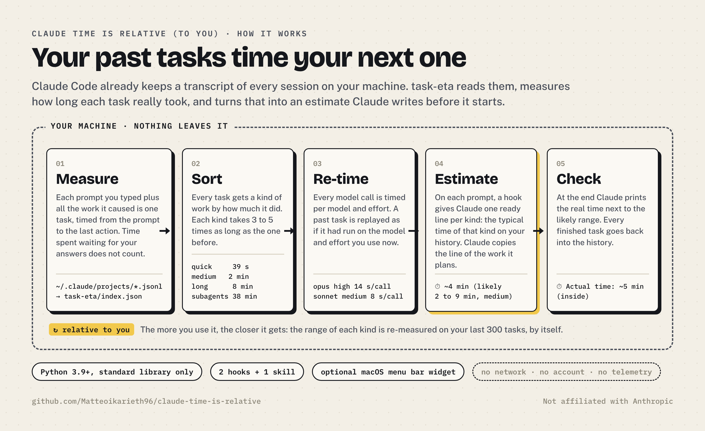
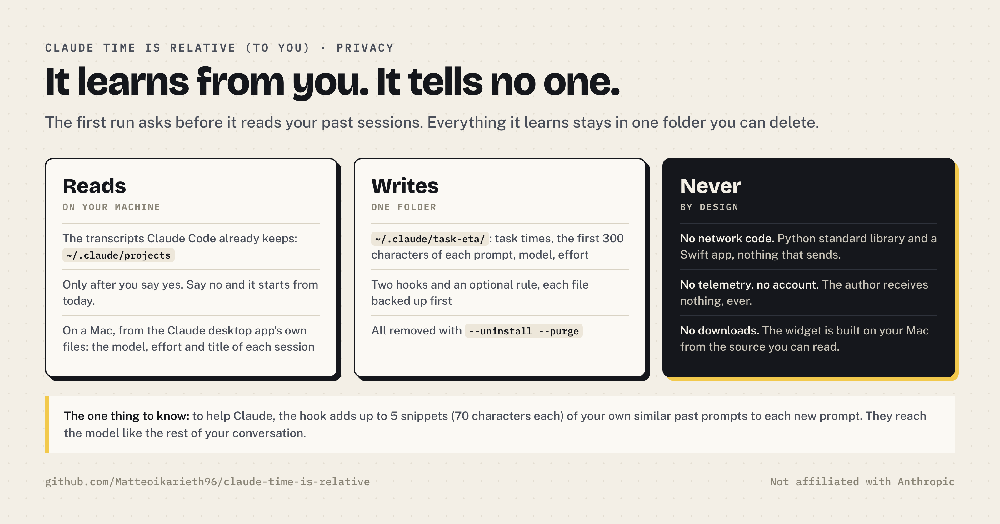
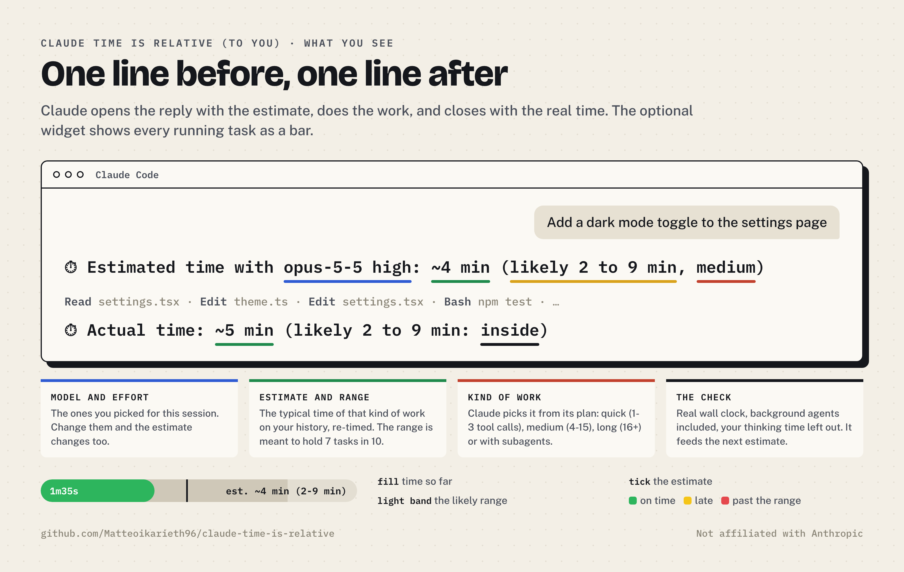
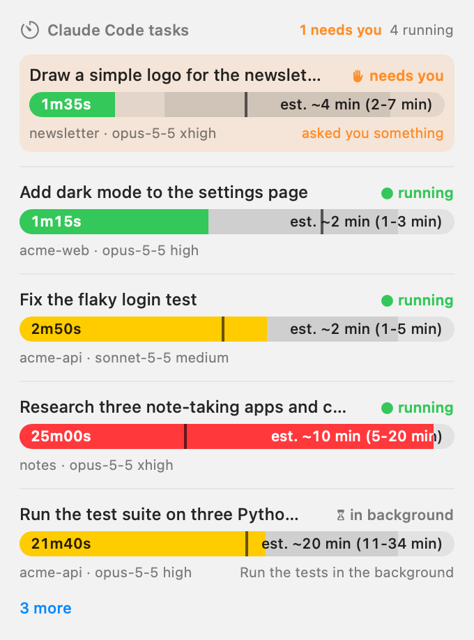
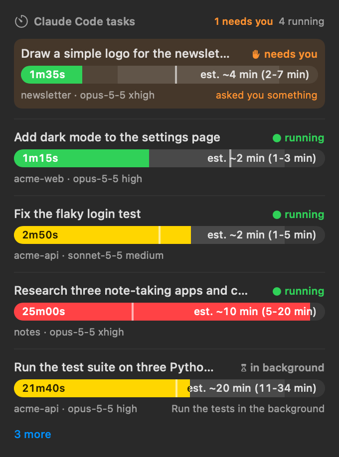
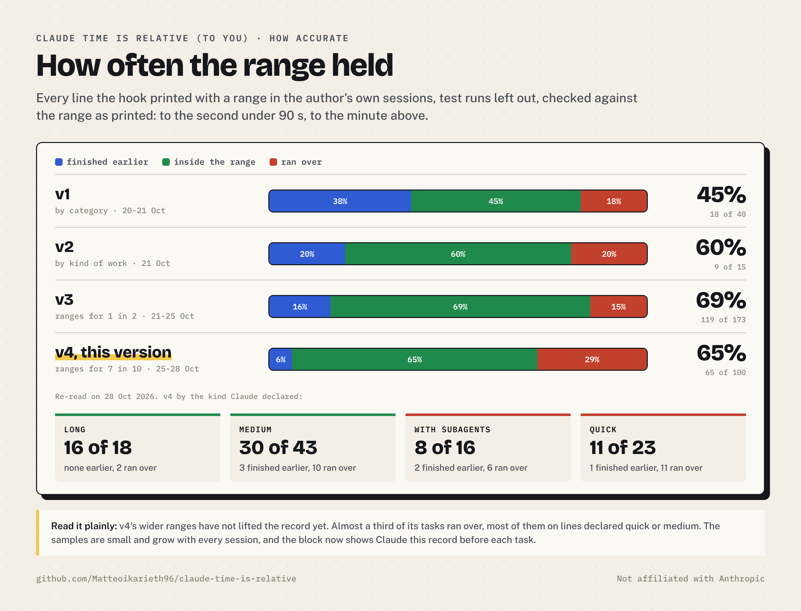
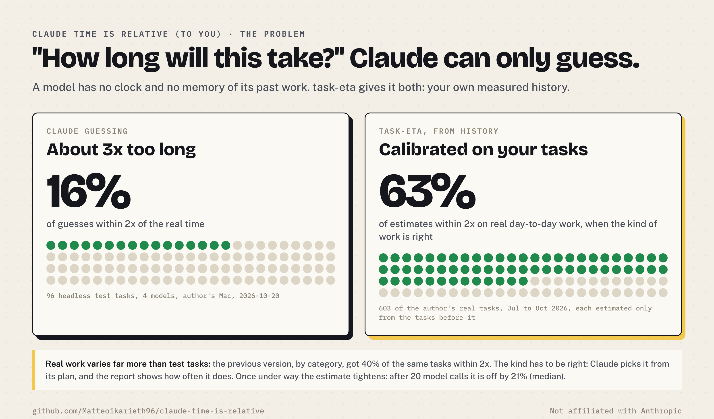

# Claude Time is relative (to you)

Time estimates for Claude Code, learned from your own past sessions, on your own machine.

> Not affiliated with Anthropic. "Claude" and "Claude Code" are Anthropic's names for its products; this is an independent open-source tool for them.

## The problem

You ask Claude Code for something. How long will it take? Claude does not know. A model has no clock and no memory of its past work, so it guesses. In 96 test tasks on the author's Mac, Claude's own guesses were about 3 times too long, and only 16% landed within 2x of the real time.

## The solution

Claude Code already keeps a transcript of every session on your computer. task-eta reads them, measures how long each of your tasks really took, and before each new task gives Claude one ready estimate per kind of work, built from that history and re-timed for the model and effort you are using. Claude knows its plan, so it picks the line for the kind of work it is about to do. When the task is done, Claude prints the real time next to it.

```
⏱ Estimated time with opus-5-5 high: ~4 min (likely 2 to 9 min, medium)
  … Claude works …
⏱ Actual time: ~5 min (likely 2 to 9 min: inside)
```

Nothing leaves your machine. The estimates are relative to you: your tasks, your models, your pace.



## Install

Needs Claude Code (CLI or desktop app), Python 3.9 or newer, macOS or Linux. The optional widget needs macOS 14+ and the Xcode Command Line Tools.

```bash
git clone https://github.com/Matteoikarieth96/claude-time-is-relative.git
```

```bash
python3 claude-time-is-relative/install.py
```

The installer first says what it reads and writes, then asks before it changes anything:

1. **Install?** Two hooks in `~/.claude/settings.json` and the skill link. No: nothing changes.
2. **Read your past sessions now?** Yes: the estimates use your own times from the first prompt. No: it starts from today, and older sessions stay unread as long as `~/.claude/task-eta/config.json`, which records the date, is there.
3. **Add a short rule to `~/.claude/CLAUDE.md`?** It makes Claude follow the format more reliably. The hook works without it.
4. **Install the TaskETA menu bar widget?** (macOS only) It is built on your Mac from the source in `widget/`, then copied to `~/Applications`. If yes: **open it at login?** Off unless you say so.

A question left unanswered counts as no. It backs up every file before changing it (in `~/.claude/task-eta/backups`, private to your user, the last 10 of each file), follows a `settings.json` or `CLAUDE.md` that is a link to your dotfiles instead of replacing it, stops with nothing changed if a file is not what it expects (not valid JSON, read-only, odd markers), never touches a hook that is not its own, and leaves alone a `~/.claude/skills/task-eta` that belongs to another skill. `--uninstall` puts `settings.json` and `CLAUDE.md` back byte for byte when nothing else changed them since the install; otherwise it removes only what task-eta added. Use `--dry-run` to see the changes first, or `--check` to see what is installed.

You can also ask Claude: *"set up task-eta from this folder"*. The skill explains the same things and asks the same questions before it runs the installer.

## Privacy



| | |
|---|---|
| **Reads** | The transcripts Claude Code already keeps in `~/.claude/projects`, only after you say yes. On a Mac with the Claude desktop app, the model, effort and title of each session from the app's own files. |
| **Writes** | `~/.claude/task-eta/`: your task times, the first 300 characters of each prompt with secrets in common formats replaced by `[secret]` (API keys and tokens by their prefix, private keys, long random strings, values after a name such as `password:` or `DB_PASSWORD=`), model and effort. Private to your user (folders 0700, files 0600). The masking works by patterns, so rotate any key you paste into a prompt anyway. The hooks in `~/.claude/settings.json`, the optional rule in `~/.claude/CLAUDE.md`, the optional app in `~/Applications`. |
| **Never** | No network code (Python standard library only, a Swift app with no networking), no telemetry, no account. The author receives nothing. |
| **Good to know** | To help Claude pick the kind of work, the hook adds up to 5 snippets (70 characters each) of your own similar past prompts from the same project to each new prompt, with secrets masked and marked as untrusted data. They reach the model like the rest of your conversation. |

Remove everything with `python3 install.py --uninstall`; add `--purge` to delete your history too.

## What you see



- **Before**: `⏱ Estimated time with <model> <effort>: ~N min (likely X to Y min, <kind>)`. The kind is how much work Claude plans: **quick** (1 to 3 tool calls), **medium** (4 to 15), **long** (16 or more), **with brief subagents** (Agent, Task or Workflow calls whose subagents all finish in under about 10 minutes) or **with subagents** (at least one researches or builds for longer). A file or document of more than about 150 lines that Claude writes counts as 3 calls, since writing it is long model time. The hook gives Claude one line per kind and Claude copies the one that matches its plan. On the author's history each kind takes 3 to 5 times as long as the one before (medians 39 s, 2 min, 8 min and 38 min), so the kind decides most of the estimate. Each kind's range is measured out of sample: the narrowest of four widths that held the real time at least one time in two (the widest if none did, the quartiles while a kind has fewer than 20 tested tasks).
- **After**: `⏱ Actual time: ~N min (likely X to Y min: inside)`. The `~` is there because the line is printed just before Claude's final reply: what usually followed this call in past sessions of the same kind (desktop app or terminal) is added, re-timed for the model in use.
- **During a long task**: Claude may add `⏱ Elapsed: 12 min · about 8 min left (likely 5 to 15 min)`, re-estimated from the work done so far.
- Times are in seconds under 90 s, otherwise in minutes (never hours).

### The widget

TaskETA lives in the menu bar: a tick and the number of tasks finished in the last 30 minutes. Click it for every running task as a bar, with the time so far, the estimate and the likely range of the kind Claude declared. Tasks waiting for your answer come first. An optional panel can sit on the desktop, under your windows (off until you turn it on in the menu). Before sharing your screen, turn on **Hide prompts and titles** in the menu: rows then show only the folder.

| Light | Dark |
|---|---|
|  |  |

Example data. Green: on time. Yellow: past the estimate. Red: past the likely range. Grey: quiet for 15 minutes.

#### Gaming Mode

Want the widget as a game? The [`gaming-mode`](https://github.com/Matteoikarieth96/claude-time-is-relative/tree/gaming-mode) branch is a gamified variant of TaskETA, contributed by [@smazzolo](https://github.com/smazzolo): a Minecraft-style mine where every estimate is a pickaxe stroke and its accuracy decides the find, a mini golf easter egg, a level map in a dashboard, and an optional iPhone widget. It lives on its own branch, apart from `main`, because it does more: the iPhone widget talks to your Mac over your local network, so read [what it adds and what it changes for privacy](https://github.com/Matteoikarieth96/claude-time-is-relative/blob/gaming-mode/GAMING-MODE.md) before you install it. To try it, install from that branch: `git clone --branch gaming-mode https://github.com/Matteoikarieth96/claude-time-is-relative.git`.

## How accurate is it



**Live, in the author's own sessions.** Every estimate the hook printed from 20 to 22 October 2026, test runs left out (119 tasks). The real time fell inside the printed range 16 of 39 times with v1 (by category, 20 to 21 October), 9 of 15 with v2 (by kind of work, 21 October) and 18 of 25 with v3 (this version, with the round 7 changes, since the evening of 21 October). A typical estimate is now off by 1.5 times either way, against 2.2 with v1, and the median task takes 1.00 times its estimate, where v1's ran 1.8 times long. The samples are small and grow with every session.



**Replayed on the author's history.** 715 real day-to-day tasks with tool calls, 30 July to 20 October 2026, automated test runs left out. Each task was estimated only from the tasks (and model speeds) that had ended before it began, as the hook would have done at the time: 715 real day-to-day tasks with tool calls, 30 July to 20 October 2026, automated test runs left out. Each task was estimated only from the tasks (and model speeds) that had ended before it began, as the hook would have done at the time:

| | Within 2x of the real time | Median error | Real time inside the likely range |
|---|---|---|---|
| Claude guessing, earlier benchmark on test tasks (96) | 16% | about 3x too long | n/a |
| Previous version, by category and similar requests (645) | 40% | 75% | 47% |
| Version of 20 October, by kind of work, when the kind is right, last 258 tasks re-measured on 21 October | 63% | | 49% |
| This version (21 October), same tasks, when the kind is right | 66% | | 55% |
| quick / medium / long / with subagents, this version | 65% / 69% / 63% / 62% | | 52% / 56% / 59% / 52% |
| Round 7 benchmark, 100 new test tasks on 5 models and efforts, the line as Claude wrote it: before the changes (10) | 20% | 68% | 10% |
| the same benchmark after the changes (89) | 58% | 52% | 54% |
| Round 8 benchmark (22 October), 182 new test tasks on Opus, Sonnet, Haiku and Fable, same code as round 7, the line as Claude wrote it | | | 49% (32% finished early, 19% over) |
| mid-task `eta`, after 20 model calls (47) | 91% | 21% | |

Two limits, said plainly. The figures for real tasks assume Claude picks the right kind: it only has to know how much work it plans, which is easier than guessing minutes, and it did on 35 of the author's last 49 tasks, 83 of 89 round 7 tasks and 162 of 182 round 8 tasks, but it can be wrong. The hook shows that score in each block and `report` shows it too. And even with the right kind, the time of one task is noisy: about 6 or 7 times in 10 within 2x. The benchmark tasks were written to be checked headless, so they differ from day-to-day work: heavy code written from scratch ran 2 to 3 times over the line, and tasks whose subagents each worked a few seconds ran far under it (round 8: 4 of 24 subagent tasks inside the range, 19 finished early). Treat the first estimate as a calibrated guess, not a promise; it narrows once the task is under way. Run `python3 task_eta.py report` to see your own numbers.

## Commands

```bash
python3 task_eta.py report          # your task times by kind, model seconds per call, estimate accuracy
python3 task_eta.py estimate "write a deck about our Q3 results"
python3 task_eta.py estimate --model sonnet-5-5 --effort medium "fix the login bug"
python3 task_eta.py status          # running and recently finished tasks
python3 task_eta.py import-sleeps   # once: leave out the sleeps macOS logged, then re-read the history
python3 install.py --check          # what is installed
python3 install.py --uninstall      # remove it all (add --purge to delete the history)
```

## How a task is measured

- A task is one prompt you typed plus all the work it caused, until the last action before your next prompt.
- Background agents and workflows belong to the task that launched them, even when they report back after you have moved on: that task runs until their report is handled, and the task you are on is not charged for it. A task whose agent has not reported back yet stays out of the statistics until it does (or for 12 hours).
- Not counted: time waiting for your answers, silences over 15 minutes inside a turn with no subagent running, pauses over an hour, time the Mac was asleep between Claude's steps (the hooks note each wake and then read macOS's power log in the background, at most once an hour; `python3 task_eta.py import-sleeps` does it at once and re-reads the history; sleep inside a single model call, a subagent's own run or a background job still counts), and the tool calls of the estimate itself (`elapsed`, `eta`) when the kind is counted.
- A session started by another session is its own task. Notifications from CI or other sessions do not stretch the task that receives them.
- Tasks where Claude only kept waking up to watch something (a long build, a print) stay in the history but out of the statistics.
- Every model call is timed per model and effort, so a past task can be replayed as if it had run on another model or effort: only the model time changes, tool time stays as it was.

## Limits

- It needs history. Estimates start after 5 tasks that used tools; a kind gets its own line once 5 past tasks were of that kind, and its likely range after about 15.
- Claude Code deletes transcripts after 30 days by default (`cleanupPeriodDays`), so a first install starts with at most a month of history. From then on the index keeps every task it has read, with a daily copy (`index.json.bak`).
- Re-timing for another effort changes only the time per model call, while effort mostly changes how many steps Claude takes.
- The estimate is your typical task of that kind. Work much heavier than your usual (writing a whole app from scratch in a few calls at xhigh effort, say) runs longer than the line: in the round 7 benchmark such tasks took 2 to 3 times the estimate, and tasks whose subagents each did a few seconds of work took far less than the "brief subagents" line.
- `report` also groups tasks by topic (coding, research, documents…) from keyword rules in English and Italian; that grouping is descriptive only and does not enter the estimate.
- The transcript format is not a public API. A Claude Code update could change it; the tests cover the parser on synthetic transcripts.
- Hooks use `sh`, so Windows is not supported.

## Files

| File | What it is |
|---|---|
| `task_eta.py` | the whole tool: parser, index, estimates, hooks, commands |
| `install.py` | install, check and uninstall, with backups |
| `SKILL.md` | the Claude Code skill: setup questions, reports, estimates on request |
| `widget/` | the TaskETA menu bar app (SwiftUI) and its build script |
| `docs/` | the images in this README; `docs/src/` has the source of the infographics except `live-gap.png`, drawn from the author's own history |
| `tests/` | unit tests on synthetic transcripts (one per finding of each security review), plus a check that no personal data is published |

Run the tests with `python3 -m unittest discover -s tests`.

## More skills by the same author

[evm-dd](https://github.com/Matteoikarieth96/evm-dd-skill) · [hiring-prep](https://github.com/Matteoikarieth96/hiring-prep-skill) · [whiteboard-video](https://github.com/Matteoikarieth96/whiteboard-video-skill) · [beer-can-label](https://github.com/Matteoikarieth96/beer-can-label-skill) · [3d-print-design](https://github.com/Matteoikarieth96/3d-print-design-skill) · [skill-release](https://github.com/Matteoikarieth96/skill-release-skill)

## License

MIT, see [LICENSE](LICENSE).
